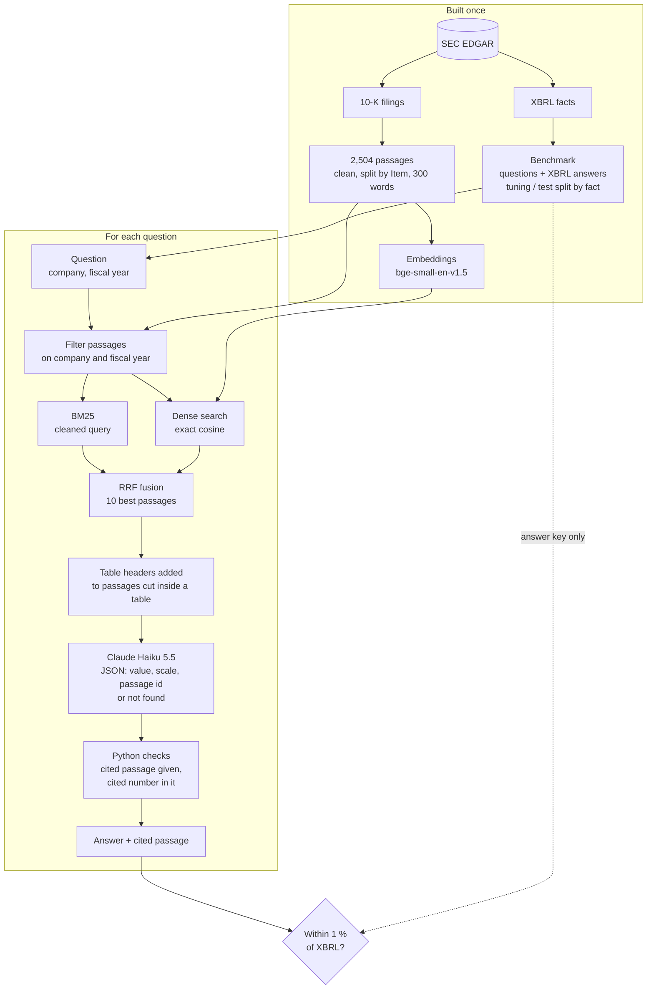

# FinAgent

FinAgent answers questions about US public companies from their annual reports (10-K), cites
the passage each answer comes from, and measures its own errors against the official XBRL
financial data published by the SEC.

**Status:** phase 1 done, a retrieval-augmented pipeline measured on a held-out test set. Next,
phase 2: an XBRL tool the model can call.

## Results (phase 1, test set, run once)

The pipeline was tuned on one half of the benchmark and measured once on the other half, frozen.
An answer is **right** when it is within 1 % of the XBRL value.

| Questions | Right | Wrong | Abstained | Rejected | Precision |
|---|---|---|---|---|---|
| All (480) | **93.8 %** | 3.1 % | 2.1 % | 1.0 % | **96.8 %** |
| Relevant passage retrieved (454) | 97.8 % | 1.8 % | 0 % | 0.4 % | 98.2 % |
| Relevant passage missed (26) | 23.1 % | 26.9 % | 38.5 % | 11.5 % | 46.2 % |
| Phrasings seen while tuning (360) | 95.0 % | 1.4 % | 2.5 % | 1.1 % | 98.6 % |
| Held-out phrasing (120) | 90.0 % | 8.3 % | 0.8 % | 0.8 % | 91.5 % |

- **Precision** is right / (right + wrong): how far a number FinAgent gives can be trusted.
  *Abstained* means the model answered "not found"; *rejected* means a Python check refused the
  answer (cited passage not given, or cited number absent from it)
- **Retrieval**: the relevant passage is among the 10 given to the model for 94.6 % of the
  test questions, 454 of 480 (BM25 + dense, fused by RRF)
- **The held-out phrasing scores lower, and the cause is the benchmark, not the pipeline.** Its
  template asks for "the *total* {label}". For long-term debt, the 10-K has a row "Total
  long-term debt" (current portion included), while the answer key is the non-current XBRL concept.
  6 of the 10 wrong answers in that phrasing are this case; the same facts asked in the seen
  phrasings are all right. Nothing was changed after the test run

**What the errors say.** When the relevant passage is retrieved, the model reads the right
figure 97.8 % of the time. 14 of the 15 wrong answers are a real figure of a *neighbouring
definition*, not an invented one: 7 because retrieval missed the financial statement and the
model took the figure of the management discussion (Amazon's "cash capital expenditures", net of
incentives, instead of purchases of property and equipment), 7 from the word "total" of the
held-out phrasing. Phase 2 targets this case: an XBRL tool that asks for the exact concept.

### What tuning changed

On the tuning set (360 questions), each fix was measured on its own:

| Pipeline | Right | Precision |
|---|---|---|
| First end-to-end run | 86.4 % | 91.5 % |
| + table header given with passages cut inside a table | 88.1 % | 93.8 % |
| + sign rule for amounts in parentheses | 90.8 % | 96.7 % |

- **Table headers.** Chunking cut tables after their header: 369 of 2,504 passages start inside
  a table, without its scale ("In millions") or its column row ("2023 | 2024"). The model then
  answered in units, or assumed the latest year comes first (Alphabet puts the oldest first).
  When a retrieved passage starts inside a table, the header is found by walking back to the
  passage that opens it, and only those few lines are added to what the model reads. The
  corpus, embeddings and retrieval are unchanged
- **Sign.** In a financial statement, parentheses give the sign in the direction of the row
  label: `(44,477)` on "Additions to property and equipment" is a cash outflow of 44,477, and
  XBRL reports capital expenditures as a positive amount. The prompt now says so

## How it works



1. **Corpus**: the last three 10-K filings of Apple, Microsoft, Alphabet, Amazon and Nvidia, cut
   into 2,504 passages of at most 300 words (see *Data pipeline* below)
2. **Benchmark**: numeric questions generated from XBRL facts, 16 concepts (revenue, net income,
   total assets, capital expenditures...) on the 15 company-years, three phrasings per fact. Split
   **by fact** with a fixed seed, so that all phrasings of a fact stay on the same side: 360
   tuning questions, 360 test questions, plus 120 test questions in a fourth phrasing never seen
   while tuning. XBRL is the answer key only, never given to the model
3. **Retrieval**: filtered on company and fiscal year first (the first cause of failure on
   FinanceBench), then BM25 on a cleaned query and dense search (`bge-small-en-v1.5`, exact
   cosine), fused by reciprocal rank fusion. The 10 best passages go to the model
4. **Generation**: Claude Haiku 5.5 answers in JSON imposed by the API: the number as written,
   its scale, and the id of the passage it comes from, or "not found". Python then checks that
   the cited passage was given and contains the cited number, and converts the answer
5. **Evaluation**: each answer is compared to the XBRL value; every answer is logged to read the
   errors one by one

LLM answers are cached on disk, keyed by a hash of everything that shapes them: a run repeated
with the same prompt reads the cached answers instead of calling the model.

## Data pipeline

Each step rebuilds its folder from the previous one.

| Folder | Content | Built by |
|---|---|---|
| `data/raw/`, `data/xbrl/` | 10-K HTML and XBRL facts as served by EDGAR, never modified | `scripts/download.py` |
| `data/text/` | Visible text, tables flattened into `cell \| cell` rows | `scripts/clean.py` |
| `data/items/` | Items 1, 1A, 7 and 8, one file each | `scripts/split.py` |
| `data/passages.jsonl` | One passage per line with its ticker, fiscal year, period end, Item and id | `scripts/passages.py` |
| `data/questions.jsonl` | Numeric questions with their XBRL answer and split | `scripts/questions.py` |
| `data/embeddings.npz` | One normalised vector per passage | `scripts/embed.py` |

The rules rely on what the 10-K format imposes, not on one company's habits:

- **Page layout is removed.** "Table of Contents" links, page numbers, repeated Part and Item
  headers and page footers are matched as whole lines; a sentence split by a page break is glued back
- **Tables keep their structure.** One row per line between `[TABLE]` markers; a one-row table is
  layout and becomes plain text; negative amounts are written `(259)`
- **An Item heading is a line that starts with "Item N." and names the Item.** Table of contents
  rows end with a page number and are skipped
- **The financial statements are found by content.** They sit in whichever Item holds the
  balance sheet title: Item 8 for most companies, Item 15 for Nvidia, whose Item 8 only refers to them
- **Anything unexpected stops the pipeline**: a missing or repeated Item, a heading that does not
  name its Item, zero or several balance sheet titles
- **Passages are at most 300 words**, cut on line breaks with a 50-word overlap, numbered from 1
  within their Item: `AAPL_2024_7_1` is the first passage of Item 7 in Apple's fiscal 2024 10-K
- **The fiscal year is the year the period ends**, as the companies name it: Nvidia's year ending
  26 January 2025 is fiscal 2025. The exact `period_end` is kept, since it is the key that matches XBRL facts

## Setup

```bash
cp .env.example .env   # then fill in your contact address and Anthropic API key
python3 -m venv .venv
.venv/bin/pip install -e ".[dev]"
.venv/bin/pytest                                   # 78 tests, no API call
.venv/bin/python scripts/download.py               # 10-K filings to data/raw/, XBRL facts to data/xbrl/
.venv/bin/python scripts/clean.py
.venv/bin/python scripts/split.py
.venv/bin/python scripts/passages.py
.venv/bin/python scripts/questions.py              # numeric questions with their XBRL answers
.venv/bin/python scripts/embed.py                  # dense vectors, about 4 minutes on CPU
.venv/bin/python scripts/evaluate_retrieval.py     # recall at k on the tuning set
.venv/bin/python scripts/ask.py --dry-run          # one question end to end, stops before the API call
.venv/bin/python scripts/evaluate_answers.py --dry-run   # retrieval only, no API call
.venv/bin/python scripts/evaluate_answers.py       # accuracy on the tuning set (--test once, at the end)
```

## Plan

1. **Data**: 10-K filings and XBRL facts from EDGAR. *Done*
2. **RAG on numeric questions**, evaluated against XBRL. *Done, results above*
3. **XBRL tool**: let the model query XBRL directly for figures, and measure the gain on a new
   benchmark whose held-out phrasing is checked against each concept before any run
4. **Text questions and CI**: risk factors and strategy questions, evaluation run on every change

## License

MIT
