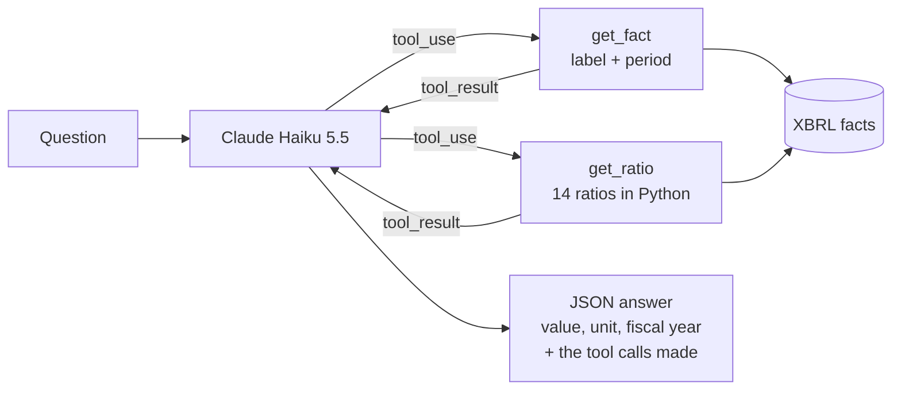
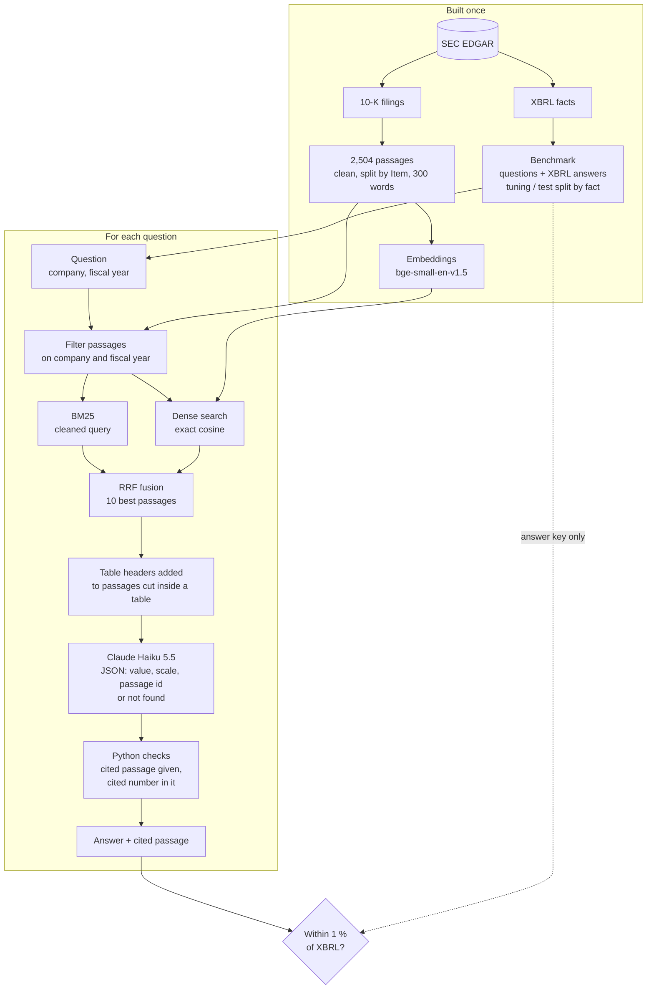

# FinAgent

FinAgent answers questions about US public companies from their annual reports (10-K) and
measures its own errors against the official XBRL financial data published by the SEC.

**Status:** phase 2 done. An agent that calls two tools, one reading XBRL facts and one computing
financial ratios in Python, measured on the same held-out test set as the retrieval-augmented
pipeline of phase 1. Next, phase 3: text questions (risks, strategy) and evaluation in CI.

## Results (phase 2, test set, run once)

Same benchmark as phase 1: 480 test questions never seen while tuning, 360 in the three tuning
phrasings and 120 in a fourth one. An answer is **right** when it is within 1 % of the XBRL value.
Phase 1 was run again on these exact questions, since phase 2 froze a new held-out phrasing.

| Questions | Agent (phase 2) | RAG (phase 1) |
|---|---|---|
| All (480) | **100 %** right, precision **100 %** | 94.6 % right, precision 98.3 % |
| Phrasings seen while tuning (360) | 100 % | 95.0 % |
| Held-out phrasing (120) | 100 % | 93.3 % |

- The agent called `get_fact` on all 480 questions, copied the period as the question states
  it (a date or a fiscal year, Nvidia's fiscal 2025 ending in January 2025), and never altered
  the figure the tool returned. The RAG loses its points where retrieval misses the passage:
  17 % right on those 29 questions, 99.6 % on the other 451
- **What 100 % does not mean.** The tool and the answer key both read XBRL, so a right concept
  and a right period give the exact figure by construction. And the benchmark asks with the
  tool's own labels: in all 480 questions, the concept the model chose is written word for word
  in the question. This benchmark measures tool use, periods and faithful copying; it does not
  measure the mapping of financial vocabulary ("sales", "top line", "debt") to a concept, which
  needs questions written in other words. The ratios are checked by unit tests (for instance
  Apple's fiscal 2025 ROIC, 103.9 %, matches a computation by hand), not by this benchmark
- Cost of the test run: $0.32 for 480 questions with Claude Haiku 5.5

**What tuning changed.** On the first 20 tuning questions, 9 were abstained without any tool
call, mostly fiscal years filed after the model's training data (Alphabet 2025, Nvidia 2026),
which it took for unpublished. Two general rules fixed it: the data goes beyond the model's
knowledge, and a figure is missing only when the tool says so. One false start remained on 360
questions: with the answer format forced on every turn, a sentence the model meant to write
before calling the tool came out as a final answer, `{"answer": "pending", "value": null}`. The
loop now sends such an answer back once. On the test, it happened once, and was recovered.

## Results (phase 1, test set, run once)

## Results (phase 1, test set, run once)

The pipeline was tuned on one half of the benchmark and measured once on the other half, frozen.
An answer is **right** when it is within 1 % of the XBRL value.

| Questions | Right | Wrong | Abstained | Rejected | Precision |
|---|---|---|---|---|---|
| All (480) | **93.8 %** | 3.1 % | 2.1 % | 1.0 % | **96.8 %** |
| Relevant passage retrieved (454) | 97.8 % | 1.8 % | 0 % | 0.4 % | 98.2 % |
| Relevant passage missed (26) | 23.1 % | 26.9 % | 38.5 % | 11.5 % | 46.2 % |
| Phrasings seen while tuning (360) | 95.0 % | 1.4 % | 2.5 % | 1.1 % | 98.6 % |
| Held-out phrasing (120) | 90.0 % | 8.3 % | 0.8 % | 0.8 % | 91.5 % |

- **Precision** is right / (right + wrong): how far a number FinAgent gives can be trusted.
  *Abstained* means the model answered "not found"; *rejected* means a Python check refused the
  answer (cited passage not given, or cited number absent from it)
- **Retrieval**: the relevant passage is among the 10 given to the model for 94.6 % of the
  test questions, 454 of 480 (BM25 + dense, fused by RRF)
- **The held-out phrasing scores lower, and the cause is the benchmark, not the pipeline.** Its
  template asks for "the *total* {label}". For long-term debt, the 10-K has a row "Total
  long-term debt" (current portion included), while the answer key is the non-current XBRL concept.
  6 of the 10 wrong answers in that phrasing are this case; the same facts asked in the seen
  phrasings are all right. Nothing was changed after the test run

**What the errors say.** When the relevant passage is retrieved, the model reads the right
figure 97.8 % of the time. 14 of the 15 wrong answers are a real figure of a *neighbouring
definition*, not an invented one: 7 because retrieval missed the financial statement and the
model took the figure of the management discussion (Amazon's "cash capital expenditures", net of
incentives, instead of purchases of property and equipment), 7 from the word "total" of the
held-out phrasing. Phase 2 targets this case: an XBRL tool that asks for the exact concept.

### What tuning changed

On the tuning set (360 questions), each fix was measured on its own:

| Pipeline | Right | Precision |
|---|---|---|
| First end-to-end run | 86.4 % | 91.5 % |
| + table header given with passages cut inside a table | 88.1 % | 93.8 % |
| + sign rule for amounts in parentheses | 90.8 % | 96.7 % |

- **Table headers.** Chunking cut tables after their header: 369 of 2,504 passages start inside
  a table, without its scale ("In millions") or its column row ("2023 | 2024"). The model then
  answered in units, or assumed the latest year comes first (Alphabet puts the oldest first).
  When a retrieved passage starts inside a table, the header is found by walking back to the
  passage that opens it, and only those few lines are added to what the model reads. The
  corpus, embeddings and retrieval are unchanged
- **Sign.** In a financial statement, parentheses give the sign in the direction of the row
  label: `(44,477)` on "Additions to property and equipment" is a cash outflow of 44,477, and
  XBRL reports capital expenditures as a positive amount. The prompt now says so

## How the agent works (phase 2)



- **The model never reads XBRL.** It reads two tool cards and fills in their arguments: a
  company, a label taken from a list (`revenue`, `long-term debt`...) and the period exactly as
  the question gives it. Python resolves the period, tries each XBRL name of the label (Apple and
  Nvidia report revenue under different concepts) and sends back the figure, or an error that
  says what exists
- **The model never does arithmetic.** `get_ratio` computes margins, free cash flow, ROE, ROIC,
  Du Pont, the working capital cycle, debt to equity, payout and effective tax rate, with
  balance sheets averaged where the definition needs it. The result states its definition, its
  inputs and caveats checked in the 10-K text (Amazon books fulfillment outside cost of revenue)
- **A missing figure is never a zero by accident.** Each input says whether its absence means 0
  (no commercial paper outstanding, checked in the filing) or an error: Nvidia's fiscal 2026
  current securities are on its balance sheet but missing from the SEC's `companyfacts` file, so
  its 2026 ROIC fails instead of returning a wrong number
- **The loop** keeps the conversation, runs every tool call of a turn, sends all the results
  back in one turn, and stops after five turns. Answers are cached on disk, keyed by the prompts,
  the tool cards and the code of the tools and of the loop

## How the RAG works (phase 1)



1. **Corpus**: the last three 10-K filings of Apple, Microsoft, Alphabet, Amazon and Nvidia, cut
   into 2,504 passages of at most 300 words (see *Data pipeline* below)
2. **Benchmark**: numeric questions generated from XBRL facts, 16 concepts (revenue, net income,
   total assets, capital expenditures...) on the 15 company-years, three phrasings per fact. Split
   **by fact** with a fixed seed, so that all phrasings of a fact stay on the same side: 360
   tuning questions, 360 test questions, plus 120 test questions in a fourth phrasing never seen
   while tuning. XBRL is the answer key only, never given to the model
3. **Retrieval**: filtered on company and fiscal year first (the first cause of failure on
   FinanceBench), then BM25 on a cleaned query and dense search (`bge-small-en-v1.5`, exact
   cosine), fused by reciprocal rank fusion. The 10 best passages go to the model
4. **Generation**: Claude Haiku 5.5 answers in JSON imposed by the API: the number as written,
   its scale, and the id of the passage it comes from, or "not found". Python then checks that
   the cited passage was given and contains the cited number, and converts the answer
5. **Evaluation**: each answer is compared to the XBRL value; every answer is logged to read the
   errors one by one

LLM answers are cached on disk, keyed by a hash of everything that shapes them: a run repeated
with the same prompt reads the cached answers instead of calling the model.

## Data pipeline

Each step rebuilds its folder from the previous one.

| Folder | Content | Built by |
|---|---|---|
| `data/raw/`, `data/xbrl/` | 10-K HTML and XBRL facts as served by EDGAR, never modified | `scripts/download.py` |
| `data/text/` | Visible text, tables flattened into `cell \| cell` rows | `scripts/clean.py` |
| `data/items/` | Items 1, 1A, 7 and 8, one file each | `scripts/split.py` |
| `data/passages.jsonl` | One passage per line with its ticker, fiscal year, period end, Item and id | `scripts/passages.py` |
| `data/questions.jsonl` | Numeric questions with their XBRL answer and split | `scripts/questions.py` |
| `data/embeddings.npz` | One normalised vector per passage | `scripts/embed.py` |

The rules rely on what the 10-K format imposes, not on one company's habits:

- **Page layout is removed.** "Table of Contents" links, page numbers, repeated Part and Item
  headers and page footers are matched as whole lines; a sentence split by a page break is glued back
- **Tables keep their structure.** One row per line between `[TABLE]` markers; a one-row table is
  layout and becomes plain text; negative amounts are written `(259)`
- **An Item heading is a line that starts with "Item N." and names the Item.** Table of contents
  rows end with a page number and are skipped
- **The financial statements are found by content.** They sit in whichever Item holds the
  balance sheet title: Item 8 for most companies, Item 15 for Nvidia, whose Item 8 only refers to them
- **Anything unexpected stops the pipeline**: a missing or repeated Item, a heading that does not
  name its Item, zero or several balance sheet titles
- **Passages are at most 300 words**, cut on line breaks with a 50-word overlap, numbered from 1
  within their Item: `AAPL_2024_7_1` is the first passage of Item 7 in Apple's fiscal 2024 10-K
- **The fiscal year is the year the period ends**, as the companies name it: Nvidia's year ending
  26 January 2025 is fiscal 2025. The exact `period_end` is kept, since it is the key that matches XBRL facts

## Setup

```bash
cp .env.example .env   # then fill in your contact address and Anthropic API key
python3 -m venv .venv
.venv/bin/pip install -e ".[dev]"
.venv/bin/pytest                                   # 146 tests, no API call
.venv/bin/python scripts/download.py               # 10-K filings to data/raw/, XBRL facts to data/xbrl/
.venv/bin/python scripts/clean.py
.venv/bin/python scripts/split.py
.venv/bin/python scripts/passages.py
.venv/bin/python scripts/questions.py              # numeric questions with their XBRL answers
.venv/bin/python scripts/embed.py                  # dense vectors, about 4 minutes on CPU
.venv/bin/python scripts/evaluate_retrieval.py     # recall at k on the tuning set
.venv/bin/python scripts/ask.py --dry-run          # one question end to end, stops before the API call
.venv/bin/python scripts/evaluate_answers.py --dry-run   # retrieval only, no API call
.venv/bin/python scripts/evaluate_answers.py       # accuracy on the tuning set (--test once, at the end)
.venv/bin/python scripts/evaluate_agent.py --dry-run     # phase 2 agent: cost estimate, no API call
.venv/bin/python scripts/evaluate_agent.py         # agent on the tuning set, 8 questions at a time
.venv/bin/python -c "from finagent.agent import ask; print(ask('What was Apple gross margin in fiscal 2025?'))"
```

## Plan

1. **Data**: 10-K filings and XBRL facts from EDGAR. *Done*
2. **RAG on numeric questions**, evaluated against XBRL. *Done, results above*
3. **XBRL tools**: an agent that reads XBRL facts and computes ratios, measured against phase 1
   on the same test set. *Done, results above*
4. **Text questions and CI**: risk factors and strategy questions through the RAG as a third
   tool, questions written in other words than the tool's labels, evaluation run on every change

## License

MIT
