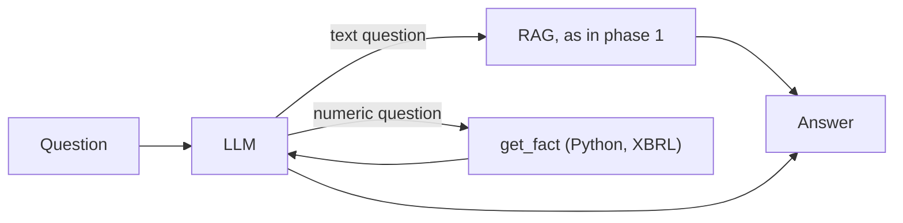

# Phase 2 design: an XBRL tool the model can call

Status: design notes, nothing implemented yet. Open choices are marked as such.

## Why

Phase 1 reads every figure from text. When the relevant passage is retrieved, the model reads
the right figure 97.8 % of the time; the wrong answers come from a neighbouring definition, a
table header lost by the chunking, or a sign read from parentheses. The figure already exists,
exact, in the SEC's XBRL data. Phase 2 lets the model ask for it instead of reading it.

## Architecture



- The model never sees the XBRL data. It sees the question, the tool description, and the
  values the code sends back
- Python fetches the figures and computes any ratio. The model never does arithmetic
- Text questions (risks, strategy) keep going through the RAG of phase 1

## The tool-use loop

The API is stateless: each call resends the whole conversation.

1. The code sends the question and the tool list (`tools`: name, description, JSON Schema of
   the arguments)
2. The model answers with a `tool_use` block (tool name, arguments it filled in, an `id`) and
   `stop_reason = "tool_use"`
3. The code runs the function with those arguments
4. The code appends the model's turn, then a `user` turn holding a `tool_result` block with the
   same `id`, and calls the API again
5. The loop stops when `stop_reason = "end_turn"`. `end_turn` means the model finished
   writing, not that the answer is right: the benchmark decides that

N calls leave 2N messages, and every call rereads the whole history, so each round costs more
than the previous one.

## Tool contract (draft)

```
get_fact(company: str, concept: str, fiscal_year: int)
```

- `company` restricted to the 15 tickers of the corpus (`enum` in the schema)
- Unknown company, concept or year: return an explicit "not found" result, never raise, so the
  model can say it does not have the figure

## Known traps

- One figure, several concepts: `Revenues` against
  `RevenueFromContractWithCustomerExcludingAssessedTax` depending on the company
- Fiscal year is not the calendar year (Apple closes at the end of September)
- Mapping the question's wording ("revenue", "total long-term debt") to the right concept is
  now the model's job: the held-out phrasing of phase 1 shows where this fails

## Open choices

- Ratios: the model chains `get_fact` calls and a computation tool, or a single
  `get_ratio(company, ratio, fiscal_year)` with each definition fixed in Python. The second
  makes fewer calls and pins each definition in tested code; the first composes any ratio
- Routing: let the model choose between the tool and the RAG, or route in Python before the call

## Measure

Same benchmark as phase 1, same split, run once on the test set: accuracy with the tool against
the 93.8 % of phase 1. Both the tool and the answer key read XBRL, so the gain measures the
mapping from question to concept and fiscal year, not the reading of a figure.
